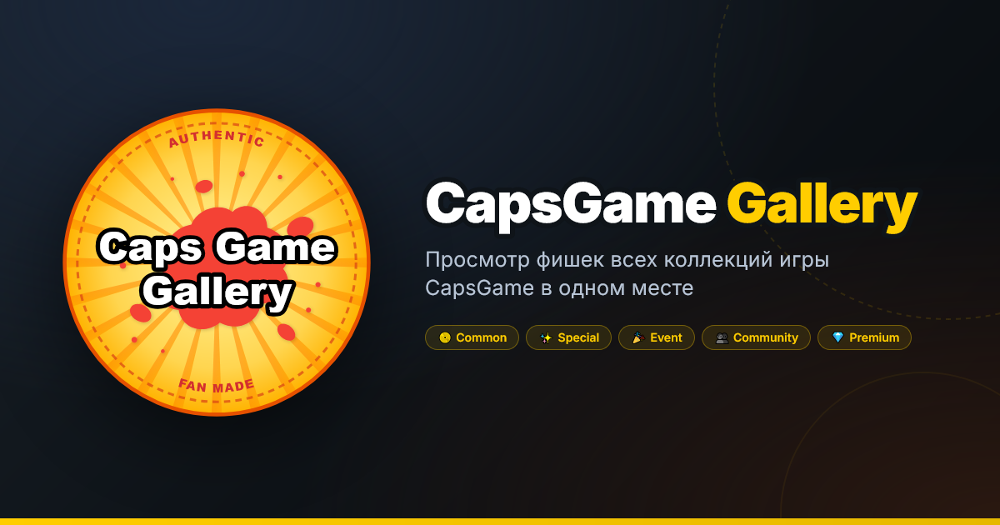

# CapsGame Gallery

Галерея фишек игры **CapsGame**. Показывает все коллекции, разбитые по типам, с логотипами и полным набором фишек в модальном окне.

Сайт полностью статический, размещён на GitHub Pages. Данные о коллекциях хранятся в одном JS-файле, который периодически обновляется скриптом синхронизации.



---

## Что внутри

| Страница | Назначение |
|---|---|
| `index.html` | Публичная галерея: табы по типам коллекций, мини-сетка, модалка с фишками |
| `admin.html` | Внутренний редактор обогащения (тираж, дата релиза, ручной размер) |
| `og-preview.html` | Шаблон OG-превью 1200×630 для соцсетей (скриншотится в `og-preview.png`) |

### Структура репозитория

``` text
├── index.html # публичная галерея
├── admin.html # редактор enrichment (локальный инструмент)
├── og-preview.html # шаблон OG-превью
├── og-preview.png # готовая картинка для соцсетей (генерируется из шаблона)
├── favicon.svg # иконка сайта
├── css/
│ └── common.css # стили галереи
├── js/
│ └── common.js # общие утилиты (URL картинок, форматирование, данные)
├── data/
│ └── collections.js # снапшот коллекций (генерируется sync.py)
├── enrichment.json # обогащённые вручную данные (тираж, дата релиза, размер)
├── sync.py # скрипт синхронизации с API CapsTradeBot
├── .env.example # Шаблон для секретов
└── .env # секреты (не коммитится)
```

## Как это работает

1. **`sync.py`** забирает список коллекций из API CapsTradeBot, мёржит с `enrichment.json`, при необходимости «пробует» размер коллекции (проверяет существование `1.png … 30.png` в Firebase Storage) и генерирует `data/collections.js`.
2. **`data/collections.js`** — это `window.CAPS_DATA = { generatedAt, count, collections: [...] }`. Подключается в `index.html` до `js/common.js`.
3. **`index.html`** читает `window.CAPS_DATA` через `js/common.js`, рисует табы, мини-сетку и модалку. Картинки логотипов и фишек берутся напрямую из Firebase Storage по шаблону URL.
4. **`admin.html`** — вспомогательный редактор: позволяет вручную заполнить тираж, дату релиза и размер, а затем экспортировать `enrichment.json`. Сам по себе ничего не сохраняет на сервере.

### Формат данных

`data/collections.js`:

```js
window.CAPS_DATA = {
  "generatedAt": "2025-01-01T12:00:00Z",
  "count": 80,
  "collections": [
    {
      "id": "90s",
      "title": "90s",
      "type": "common",
      "size": 21,
      "sizeSource": "probe",     // probe | manual | unknown
      "supply": 175000,
      "releasedAt": "2024-05-01"
    }
  ]
};
```

`enrichment.json`:

``` json
{
  "90s": { "supply": 175000, "releasedAt": "2024-05-01", "size": 21 },
  "kaidzen": { "supply": 2000 }
}
```

Поля `size`, `supply`, `releasedAt` опциональны. Если `size` задан в `enrichment` — он получает `sizeSource: "manual"` и `sync.py` больше не пробует его автоматически.

## Установка и запуск

### Установка

``` bash
python3 -m venv .venv
source .venv/bin/activate
pip install requests
```

### Настройка

```
cp .env.example .env
# вписать CAPSTRADE_TOKEN, при желании NTFY_*
```

### Запуск
```
python3 sync.py --dry-run     # только посмотреть план, ничего не писать
python3 sync.py --no-push     # записать data/collections.js, но не коммитить
python3 sync.py               # полный цикл: запись + git commit + push
python3 sync.py --force       # перепробовать размеры даже если size уже известен

```

### Cron (пример: раз в сутки в 03:00 UTC)
```
0 3 * * * cd /path/to/repo && /path/to/.venv/bin/python sync.py 2>&1 | logger -t caps-gallery
```

## Обновление данных

### Ручное обогащение через админку

1. Открыть `admin.html`.
2. Заполнить тираж / дату релиза / размер.
3. Нажать **Экспорт** `enrichment.json` — файл скачается.
4. Положить его в корень репозитория (заменить существующий).
5. Запустить `sync.py` — новые значения попадут в `data/collections.js`.

Импорт (`Импорт JSON`) позволяет загрузить ранее сохранённый `enrichment.json` обратно в редактор — удобно при работе с другого устройства.

### OG-превью

`og-preview.html` — это HTML-шаблон 1200×630. Готовый `og-preview.png` лежит в репозитории и подключён в мета-тегах `index.html`. После изменения шаблона перегенерируйте PNG

### Зависимости

- **Публичная часть**: ноль зависимостей. Шрифт Inter и Bootstrap Icons подключаются с CDN.
- **`sync.py`**: Python 3.10+, пакет `requests`.

## Лицензия

Данные о коллекциях принадлежат игре CapsGame. Код галереи — внутренний проект сообщества.